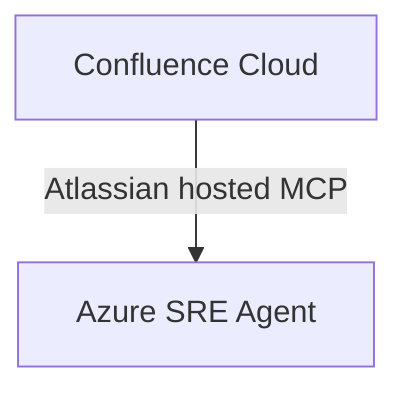

# Azure SRE Agent Confluence MCP Demo

## Overview

This small feasibility demo attempts to let Azure SRE Agent search and read synthetic content in Confluence Cloud through Atlassian's hosted Model Context Protocol (MCP) server.

## What this demo proves

When the manual test succeeds, it demonstrates that Azure SRE Agent can connect to an MCP server with Confluence tools, find a page, read it, and answer questions grounded in that page. It is not a production solution.

## What this demo does not prove

This demo does not demonstrate production readiness, governance or Azure Policy scanning, policy enforcement, automated remediation, safe use with confidential organizational content, or support for every Atlassian or Azure account configuration.

## Architecture



## Prerequisites

- An Azure subscription and access to Azure SRE Agent.
- An Atlassian account and a Confluence Cloud site where you can create a page.
- Atlassian MCP access and the authentication method offered by the connector.

Microsoft documents OAuth for supported remote servers and token/API-key or custom-header and managed-identity options for MCP connectors, depending on the server. Atlassian documents interactive OAuth 2.1 and API-token authentication (the latter may require administrator enablement). These documented options do not establish that the products' authentication methods interoperate.

Atlassian documents the hosted MCP server and OAuth 2.1, but the reviewed public documentation does not establish that a personal Atlassian account or a Free Confluence plan is sufficient for Rovo MCP/search. Rovo credit allowances vary by plan, and Rovo enablement may require an organization administrator and a verified business domain. Treat personal/Free account eligibility and any credit requirement as **requiring manual validation** before relying on this demo.

## Create the sample Confluence page

Create a Confluence page with this exact title and content. This is synthetic demonstration content, not guidance for any real organization:

```text
# Sample Azure Resource Location Guidelines

This page contains fictional rules for demonstration purposes only.
These rules are not recommendations or policies for any real organization.

## Rules

- Example production Storage Accounts must use Korea Central.
- Example production Key Vaults must use Korea Central.
- Example non-production resources may use Korea Central or Korea South.
```

## Connect Azure SRE Agent to Confluence

The direct connection below is a **manual compatibility test**, not a verified integration. Microsoft documents generic remote MCP connectors and Atlassian documents its server, but neither documentation set confirms this specific pairing or its authentication interoperability.

1. Open [Azure SRE Agent](https://sre.azure.com/) and select your agent.
2. Follow Microsoft's current [MCP connector tutorial](https://learn.microsoft.com/en-us/azure/sre-agent/mcp-connector) to add an MCP Server connector. The documented portal path is **Build + setup > Extensions > Connectors > Add connector**; portal labels can change.
3. Use Atlassian's official endpoint: `https://mcp.atlassian.com/v2/mcp`.
4. Choose OAuth sign-in if the connector offers it for this server, then complete Atlassian's consent flow. Atlassian documents OAuth 2.1 for interactive MCP access; Azure SRE Agent documents OAuth for supported remote servers. Compatibility between these implementations is not confirmed. Do not assume that selecting OAuth will work.
5. Add/save the connector. Confirm that its status becomes **Connected** as described in the Microsoft tutorial. If the connection fails, stop and use the checks in [Troubleshooting](#troubleshooting); do not substitute a credential or grant broader access without understanding the failure.
6. Follow Microsoft's instructions to select tools for the agent. Atlassian's v2 server uses `discover` to find deferred tools and `executeRead` for read operations; use its [supported tools](https://developer.atlassian.com/cloud/rovo-mcp/guides/supported-tools/) and [Rovo search and fetch guide](https://support.atlassian.com/atlassian-ai-gateway/docs/use-rovo-search-and-fetch-in-the-atlassian-remote-mcp-server/) to make only Confluence search and fetch/read capabilities available. Keep `executeWrite`, destructive operations, and any write-capable Confluence permission groups unavailable. Tool visibility depends on authentication, account permissions, and administrator controls; confirm the actual tools offered in your session.
7. Verify the connector status and that the agent can discover and invoke the read-only Confluence search and page-read capabilities before proceeding to the prompts below.

Atlassian also documents API-token authentication for some configurations, but it may require administrator enablement and may expose fewer tools. This repository does not claim that it works with Azure SRE Agent. Do not put an API token in this repository or commit local connector configuration.

## Test the integration

Ask the agent:

```text
Search Confluence for "Sample Azure Resource Location Guidelines".
```

```text
Read the "Sample Azure Resource Location Guidelines" page and summarize its rules.
```

```text
According to the Confluence page, can an example production Storage Account be deployed in Japan East?
```

Expected answer:

> No. According to the sample page, example production Storage Accounts must use Korea Central.

Then test grounding:

```text
Does the page define a location rule for Azure Container Apps?
```

The answer should say that the page does not define such a rule. The agent must not invent missing content. If an answer cannot be traced to the page, the demo has not demonstrated grounding.

## Troubleshooting

| Problem | Likely cause and next check |
| --- | --- |
| Connector cannot connect | Confirm the endpoint and remote MCP settings against Microsoft's current connector guide. This product pairing is not documented as verified. |
| OAuth or token authentication fails | Confirm the authentication methods currently offered by Azure SRE Agent and Atlassian's OAuth/API-token requirements. Their compatibility may be the blocker; do not assume a token/header workaround. |
| Page cannot be found | Confirm the page was published in the connected site, the title matches, and the authenticated account can access it. |
| Expected Confluence tools are missing | Check Atlassian's tool discovery and permission-group documentation, the connector's selected tools, and the user's site permissions. |
| Personal or Free plan cannot use MCP | Personal/Free eligibility is not established by the reviewed documentation. Check current Atlassian plan and Rovo availability for the account. |
| Rovo or credits are required | Check Atlassian's current [Rovo usage limits](https://support.atlassian.com/rovo/docs/rovo-usage-limits/) and the site's plan/admin eligibility. |
| Azure and Atlassian authentication are incompatible | Treat this as an unresolved feasibility blocker. Do not add a custom bridge unless a specific required compatibility gap is verified and a small read-only solution is justified. |

## Cleanup

- Remove the MCP connector from Azure SRE Agent using the current connector management UI.
- Revoke Atlassian OAuth consent or revoke/delete any API token created for the test, using Atlassian account security settings.
- Delete the synthetic Confluence page if you no longer need it.

## Known limitations

- **Documented:** Atlassian hosts an MCP endpoint at `https://mcp.atlassian.com/v2/mcp`, documents OAuth 2.1 and Confluence search/fetch capabilities, and applies the authenticated user's permissions. Microsoft documents remote MCP connectors and selectable tools.
- **Not verified:** Azure SRE Agent's direct interoperability with Atlassian MCP, including the end-to-end OAuth flow and tool discovery.
- **Requires hands-on validation:** Personal-account and Free-plan eligibility; whether this site/account needs Rovo enablement or credits; whether the required read-only tools appear and work; and whether the synthetic page can be searched and fetched by the agent.
- **Scope:** This repository contains no custom MCP service, application code, or Azure deployment. The test only covers reading one synthetic Confluence page.

## References

- Microsoft, [Set up the MCP connector in Azure SRE Agent](https://learn.microsoft.com/en-us/azure/sre-agent/mcp-connector)
- Microsoft, [MCP connectors and tools](https://learn.microsoft.com/en-us/azure/sre-agent/mcp-connectors)
- Atlassian, [Get started with the Atlassian MCP server](https://support.atlassian.com/atlassian-ai-gateway/docs/get-started-with-the-atlassian-remote-mcp-server/)
- Atlassian, [Authentication and authorization](https://support.atlassian.com/atlassian-ai-gateway/docs/authentication-and-authorization/)
- Atlassian, [Supported tools](https://developer.atlassian.com/cloud/rovo-mcp/guides/supported-tools/)
- Atlassian, [Use Rovo search and fetch](https://support.atlassian.com/atlassian-ai-gateway/docs/use-rovo-search-and-fetch-in-the-atlassian-remote-mcp-server/)
- Atlassian, [Rovo usage limits](https://support.atlassian.com/rovo/docs/rovo-usage-limits/)
