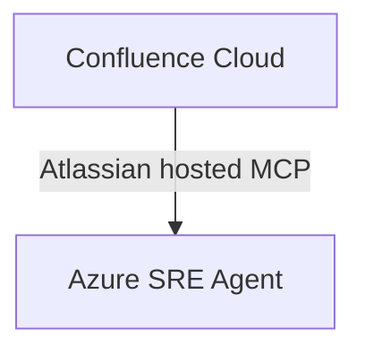

# Architecture

## Objective and selected design

Test whether Azure SRE Agent can search and read one synthetic Confluence Cloud page through Atlassian's hosted MCP server. The selected design uses the official hosted endpoint, `https://mcp.atlassian.com/v2/mcp`; no custom code or deployment is included because direct integration should be tested before adding a bridge.

## Authentication and compatibility

For the intended interactive flow, the connector starts Atlassian OAuth authorization, the user signs in and consents, and MCP requests are authorized using that user's existing Atlassian permissions. Atlassian documents OAuth 2.1; Azure SRE Agent documents OAuth for supported remote MCP servers as well as other connector authentication options. The reviewed public documentation does not explicitly document direct Azure SRE Agent-to-Atlassian MCP compatibility or confirm that their OAuth implementations interoperate.

Therefore, adding the connector, completing authentication, confirming a connected status, and discovering and invoking read-only Confluence search and fetch tools remain manual tests. Personal-account and Free-plan eligibility, Rovo requirements or credits, and the availability of the necessary tools for a given site also require validation. Keep write and destructive capabilities disabled.
